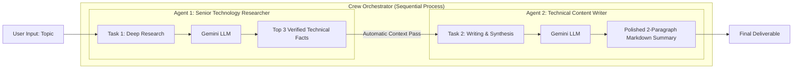

# 🚀 CrewAI Mastery: Step-by-Step Hands-On Guide for Beginners

> **A practical, production-ready tutorial crafted for aspirants and AI engineers to understand, build, and run multi-agent workflows using CrewAI.**

---

## 📌 Table of Contents
1. [What is CrewAI? (Mental Model)](#1-what-is-crewai-mental-model)
2. [The 4 Core Building Blocks](#2-the-4-core-building-blocks)
3. [Architecture & Workflow Visualized](#3-architecture--workflow-visualized)
4. [Prerequisites & Environment Setup](#4-prerequisites--environment-setup)
5. [Step-by-Step Implementation Guide](#5-step-by-step-implementation-guide)
   - [Step 1: Environment & LLM Configuration](#step-1-environment--llm-configuration)
   - [Step 2: Defining Agents (Role, Goal, Backstory)](#step-2-defining-agents-role-goal-backstory)
   - [Step 3: Defining Tasks & Expected Outputs](#step-3-defining-tasks--expected-outputs)
   - [Step 4: Assembling the Crew & Process](#step-4-assembling-the-crew--process)
   - [Step 5: Dynamic Kickoff & Execution](#step-5-dynamic-kickoff--execution)
6. [Complete Working Code (`crewAI_Agent.py`)](#6-complete-working-code)
7. [Running the Code & Understanding Terminal Output](#7-running-the-code--understanding-terminal-output)
8. [Common Pitfalls & Expert Tips](#8-common-pitfalls--expert-tips)
9. [Hands-On Practice Exercises for Aspirants](#9-hands-on-practice-exercises-for-aspirants)

---

## 1. What is CrewAI? (Mental Model)

Traditional LLM workflows send a single prompt to a single model and hope for the best. In real-world companies, complex goals are solved by **teams of specialized people collaborating together**.

**CrewAI** brings this exact organization structure to Autonomous AI Agents:
- Instead of one prompt doing research, analysis, and writing all at once, you assign **distinct roles** to separate agents.
- Each agent has its own **personality, goals, tools, and constraints**.
- Tasks execute in order, automatically passing their outputs to the next agent in line like a relay baton.

> 💡 **Analogy:** Think of CrewAI like a tech publishing team:
> - **Senior Researcher:** Gathers benchmark data and cuts through marketing fluff.
> - **Technical Writer:** Takes raw data and transforms it into an engaging summary.
> - **Crew Manager (CrewAI):** Makes sure the researcher finishes first and delivers notes to the writer.

---

## 2. The 4 Core Building Blocks

CrewAI is built around 4 primary concepts:

| Building Block | Real-World Equivalent | Responsibility in CrewAI |
| :--- | :--- | :--- |
| **`Agent`** | Team Member / Specialist | Autonomous persona with a `role`, `goal`, and `backstory`. |
| **`Task`** | Assignment / JIRA Ticket | Concrete unit of work with a `description`, `expected_output`, and assigned `agent`. |
| **`Crew`** | Department / Project Team | Orchestrator holding agents, tasks, and configuration together. |
| **`Process`** | Project Management Workflow | Strategy for execution (e.g., `Process.sequential` or `Process.hierarchical`). |

---

## 3. Architecture & Workflow Visualized

Here is the exact dataflow executed in this project:



---

## 4. Prerequisites & Environment Setup

Follow these steps to set up a clean, isolated Python environment.

### 4.1 Install Python
Make sure you have **Python 3.10, 3.11, or 3.12** installed:
```bash
python3 --version
```

### 4.2 Create & Activate a Virtual Environment
```bash
# Create virtual environment
python3 -m venv .venv

# Activate on macOS/Linux:
source .venv/bin/activate

# Activate on Windows:
# .venv\Scripts\activate
```

### 4.3 Install Dependencies
Install CrewAI and supporting packages:
```bash
pip install crewai python-dotenv google-genai
```

### 4.4 Set Up API Credentials
1. Obtain a Google Gemini API key from [Google AI Studio](https://aistudio.google.com/).
2. Create a `.env` file in the project root:
```bash
touch .env
```
3. Add your key inside `.env`:
```env
GOOGLE_API_KEY=your_actual_gemini_api_key_here
```

> [!WARNING]
> Never commit your `.env` file to Git! Ensure `.env` is listed in your `.gitignore`.

---

## 5. Step-by-Step Implementation Guide

### Step 1: Environment & LLM Configuration
Load your environment variables and configure CrewAI's universal `LLM` class.

```python
import os
from dotenv import load_dotenv
from crewai import Agent, Task, Crew, Process, LLM

# Load .env into os.environ
load_dotenv()

# Initialize LLM wrapper
# Format: "provider/model_name"
llm = LLM(
    model="gemini/gemini-3.8-flash",
    api_key=os.getenv("GOOGLE_API_KEY"),
    temperature=0.3  # Lower temperature = higher factual adherence
)
```

> **Why `LLM` class?** CrewAI's `LLM` class provides a unified interface. You can switch from Gemini to OpenAI (`openai/gpt-4o-mini`), Claude (`anthropic/claude-3-5-sonnet`), or Groq (`groq/llama-3.1-70b-versatile`) by changing only the `model` string.

---

### Step 2: Defining Agents (Role, Goal, Backstory)

An agent's behavior is dictated by three critical prompt parameters:
- `role`: Defines domain authority (Who are you?).
- `goal`: Defines the objective and evaluation standard (What are you trying to accomplish?).
- `backstory`: Defines tone, bias, skepticism, and operational boundaries (Why do you act this way?).

```python
# Agent 1: The Researcher
researcher = Agent(
    role="Senior Technology Researcher",
    goal="Discover the top 3 verified technical facts about {topic}",
    backstory=(
        "You are a veteran software analyst who loves data and hates "
        "marketing hype. You only provide concrete facts and benchmarks."
    ),
    llm=llm,
    verbose=True  # Enables live execution logs in your terminal
)

# Agent 2: The Writer
writer = Agent(
    role="Technical Content Writer",
    goal="Turn raw technical facts into a simple, beginner-friendly 2-paragraph post",
    backstory=(
        "You are a friendly developer educator who explains complex "
        "tech topics so simply that anyone can understand."
    ),
    llm=llm,
    verbose=True
)
```

> 💡 **Notice the `{topic}` variable:** CrewAI supports dynamic placeholders. When you run `kickoff(inputs={"topic": "..."})`, CrewAI automatically injects the value into all `{topic}` tags!

---

### Step 3: Defining Tasks & Expected Outputs

Every task must have:
1. `description`: Clear instructions on what the agent must do.
2. `expected_output`: Explicit criteria for formatting and completeness.
3. `agent`: The specific agent responsible.

```python
# Task 1: Research
task_research = Task(
    description="Research the topic: '{topic}'. Identify the top 3 concrete technical reasons or advantages.",
    expected_output="A bulleted list of 3 verified technical facts with brief explanations.",
    agent=researcher
)

# Task 2: Writing (Consumes output from Task 1)
task_write = Task(
    description="Using the bulleted facts provided by the researcher, write a crisp 2-paragraph beginner summary on '{topic}'.",
    expected_output="A clean 2-paragraph Markdown post with a title and bullet points.",
    agent=writer
)
```

> [!NOTE]
> **Automatic Context Hand-off:** In a sequential crew, CrewAI automatically passes the completion output of `task_research` as context to `task_write`. You do not need to write manual glue code!

---

### Step 4: Assembling the Crew & Process

Combine the agents and tasks into a unified team:

```python
my_crew = Crew(
    agents=[researcher, writer],
    tasks=[task_research, task_write],
    process=Process.sequential,  # Runs task 1 first, then task 2
    verbose=True                # Visualizes delegation and hand-offs
)
```

---

### Step 5: Dynamic Kickoff & Execution

Trigger the crew by calling `kickoff()` and passing input variables:

```python
if __name__ == "__main__":
    topic_input = "Why developers are switching from Flask to FastAPI"
    print(f"\n🚀 Starting Crew with topic: '{topic_input}'\n")

    result = my_crew.kickoff(inputs={"topic": topic_input})

    print("\n" + "=" * 50)
    print("🎉 FINAL DELIVERABLE PRODUCED BY THE CREW:")
    print("=" * 50)
    print(result)
```

---

## 6. Complete Working Code

The complete, self-contained implementation is located in [`crewAI_Agent.py`](file:///Users/rameshwer/crewai/crewAI_Agent.py):

```python
# ==============================================================================
# IMPORTS
# ==============================================================================
import os
from dotenv import load_dotenv
from crewai import Agent, Task, Crew, Process, LLM

# ==============================================================================
# 1. ENVIRONMENT & MODEL SETUP
# ==============================================================================
load_dotenv()

llm = LLM(
    model="gemini/gemini-3.8-flash",
    api_key=os.getenv("GOOGLE_API_KEY"),
    temperature=0.3
)

# ==============================================================================
# 2. DEFINING THE AGENTS
# ==============================================================================
researcher = Agent(
    role="Senior Technology Researcher",
    goal="Discover the top 3 verified technical facts about {topic}",
    backstory=(
        "You are a veteran software analyst who loves data and hates "
        "marketing hype. You only provide concrete facts and benchmarks."
    ),
    llm=llm,
    verbose=True
)

writer = Agent(
    role="Technical Content Writer",
    goal="Turn raw technical facts into a simple, beginner-friendly 2-paragraph post",
    backstory=(
        "You are a friendly developer educator who explains complex "
        "tech topics so simply that anyone can understand."
    ),
    llm=llm,
    verbose=True
)

# ==============================================================================
# 3. DEFINING INTERCONNECTED TASKS
# ==============================================================================
task_research = Task(
    description="Research the topic: '{topic}'. Identify the top 3 concrete technical reasons or advantages.",
    expected_output="A bulleted list of 3 verified technical facts with brief explanations.",
    agent=researcher
)

task_write = Task(
    description="Using the bulleted facts provided by the researcher, write a crisp 2-paragraph beginner summary on '{topic}'.",
    expected_output="A clean 2-paragraph Markdown post with a title and bullet points.",
    agent=writer
)

# ==============================================================================
# 4. ASSEMBLING THE CREW
# ==============================================================================
my_crew = Crew(
    agents=[researcher, writer],
    tasks=[task_research, task_write],
    process=Process.sequential,
    verbose=True
)

# ==============================================================================
# 5. EXECUTION ENTRY POINT
# ==============================================================================
if __name__ == "__main__":
    topic_input = "Why developers are switching from Flask to FastAPI"
    print(f"\n🚀 Starting Crew with topic: '{topic_input}'\n")

    result = my_crew.kickoff(inputs={"topic": topic_input})

    print("\n" + "=" * 50)
    print("🎉 FINAL DELIVERABLE PRODUCED BY THE CREW:")
    print("=" * 50)
    print(result)
```

---

## 7. Running the Code & Understanding Terminal Output

Run the script from your terminal:
```bash
python3 crewAI_Agent.py
```

### What happens behind the scenes?
1. **Crew Initialization**: The orchestrator parses inputs `{"topic": "Why developers are switching from Flask to FastAPI"}` and injects them into the agent goals and task descriptions.
2. **Phase 1 (Researcher Agent)**:
   - Starts working on `task_research`.
   - Logs its thoughts in terminal (because `verbose=True`).
   - Outputs 3 technical facts (e.g., Asynchronous ASGI performance, Pydantic data validation, Automatic Swagger/OpenAPI documentation).
3. **Context Handoff**: CrewAI takes the researcher's final text and feeds it into the prompt context for `task_write`.
4. **Phase 2 (Writer Agent)**:
   - Reads the 3 facts.
   - Synthesizes them into a readable 2-paragraph post.
5. **Final Output**: `kickoff()` returns a `CrewOutput` object containing the final deliverable.

---

## 8. Common Pitfalls & Expert Tips

### ❌ Pitfall 1: Vague `expected_output`
- **Bad:** `expected_output="A good report"`
- **Good:** `expected_output="A 2-paragraph markdown summary with an H2 heading and 3 bullet points."`
- *Why:* LLMs perform significantly better when given structural boundaries.

### ❌ Pitfall 2: Overlapping Agent Roles
- Do not make Agent 1 and Agent 2 do the same thing. One should gather/analyze, and the other should format/synthesize. Clear boundaries prevent repetitive loops.

### ❌ Pitfall 3: Missing Environment Variables
- Always verify `os.getenv("GOOGLE_API_KEY")` is returning a valid string. If it returns `None`, check that your `.env` file is named correctly (starting with a period) and in the same working directory.

### 💡 Expert Tip: Direct File Export
You can save task output directly to a file by setting `output_file`:
```python
task_write = Task(
    description="...",
    expected_output="...",
    agent=writer,
    output_file="final_article.md"  # Automatically saves output to disk!
)
```

---

## 9. Hands-On Practice Exercises for Aspirants

To test your understanding, try implementing these 3 progressive challenges:

### 🥉 Level 1 (Beginner): Dynamic CLI Input
Modify `crewAI_Agent.py` so the user can type any topic they want when running the script:
```python
user_topic = input("Enter a topic for the Crew to analyze: ")
result = my_crew.kickoff(inputs={"topic": user_topic})
```

### 🥈 Level 2 (Intermediate): Add an Editor / QA Agent
Add a 3rd Agent (`Senior Editor`) and a 3rd Task (`task_edit`):
1. **Agent:** Role = "Senior Editor", Goal = "Proofread and polish content for technical accuracy and tone".
2. **Task:** Review the writer's post, fix any grammatical flaws, and add an engaging "Key Takeaway" callout box at the end.
3. Update `agents=[researcher, writer, editor]` and `tasks=[task_research, task_write, task_edit]`.

### 🥇 Level 3 (Advanced): Add Web Search Tools
Equip the researcher agent with a real search tool (e.g., `from crewai_tools import SerperDevTool`) so it can fetch live, real-time web results instead of relying solely on the LLM's pre-trained memory.

---

## 🎓 Summary Checklist

- [x] Installed `crewai`, `python-dotenv`, and dependencies
- [x] Configured `.env` with API Key
- [x] Created `Agent` with `role`, `goal`, and `backstory`
- [x] Created `Task` with `description`, `expected_output`, and `agent`
- [x] Linked agents and tasks in `Crew(process=Process.sequential)`
- [x] Executed using `my_crew.kickoff(inputs={...})`

*Happy Building with CrewAI!*
