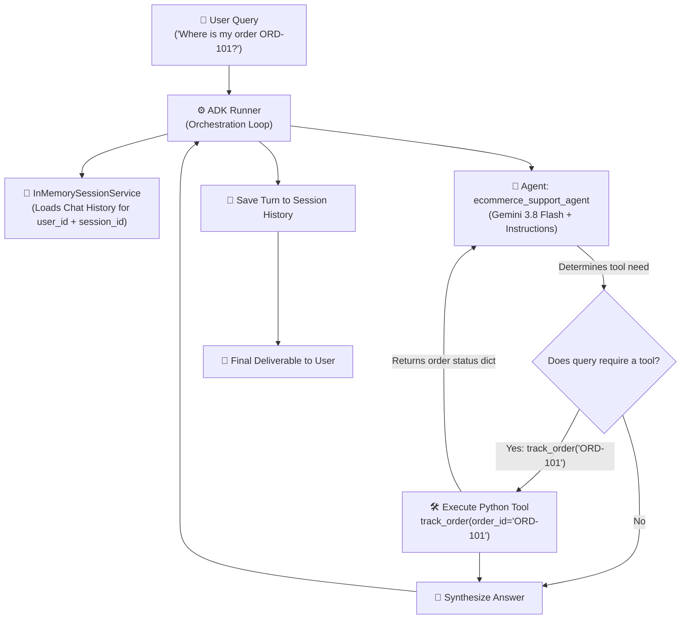

# ⚡ Google ADK (Agent Development Kit): Complete 60-Minute Workshop & Lecture Notes

> **A structured, hands-on masterclass curriculum and technical reference for learning and teaching Google's Agent Development Kit (ADK) with Gemini.**

---

## 📌 Table of Contents
1. [The Mental Model: LLMs vs. Autonomous Agents](#1-the-mental-model-llms-vs-autonomous-agents)
2. [The 4 Core Building Blocks of Google ADK](#2-the-4-core-building-blocks-of-google-adk)
3. [Architecture & Workflow Visualized](#3-architecture--workflow-visualized)
4. [Prerequisites & Environment Setup](#4-prerequisites--environment-setup)
5. [The Master Implementation: `adk_agent.py`](#5-the-master-implementation-adk_agentpy)
6. [Deep-Dive: How Function Calling Works in ADK](#6-deep-dive-how-function-calling-works-in-adk)
7. [Multi-Turn Memory: Sessions & State Management](#7-multi-turn-memory-sessions--state-management)
8. [Interactive Terminal Testing: `adk_terminal_demo.py`](#8-interactive-terminal-testing-adk_terminal_demopy)
9. [Production Deployment: Serving with FastAPI (`adk_fastapi_server.py`)](#9-production-deployment-serving-with-fastapi)
10. [Common Pitfalls & Best Practices Cheatsheet](#10-common-pitfalls--best-practices-cheatsheet)
11. [Hands-On Practice Exercises for Students](#11-hands-on-practice-exercises-for-students)

---

## 1. The Mental Model: LLMs vs. Autonomous Agents

A standard LLM call (e.g. `client.models.generate_content`) is a **one-way, single-turn calculator**: you give it text, it predicts tokens, and it returns text. It cannot:
- Check a database
- Cancel an order
- Remember a conversation across separate turns without manual prompt stitching
- Decide autonomously which tool to call and execute it in a closed loop

**Google ADK (Agent Development Kit)** turns Gemini into an **autonomous agent with hands, memory, and reasoning loops**:

| Capability | Raw Gemini API | Google ADK Framework |
| :--- | :--- | :--- |
| **Reasoning** | Single prompt completion | Multi-step autonomous execution loop |
| **Tool Calling** | Returns function call arguments to you; you must execute manually | **Executes Python functions automatically** and feeds results back to the model |
| **Conversational State** | Developer manually appends message lists | **`InMemorySessionService`** persists multi-turn history automatically |
| **Execution Controller** | Custom `while` loops | **`Runner`** handles reasoning, tool resolution, and streaming events |

---

## 2. The 4 Core Building Blocks of Google ADK

Google ADK is designed around 4 primary abstractions:

| Component | Class Name | Responsibility |
| :--- | :--- | :--- |
| **1. Agent** | `Agent` | The persona, system prompt instructions, chosen Gemini model (`gemini-3.8-flash`), and registered tools. |
| **2. Tools** | Python functions | Pure Python functions with type hints and docstrings. ADK converts these into OpenAPI/JSON schemas for Gemini. |
| **3. Session Service** | `InMemorySessionService` | Manages conversation memory and state per `(app_name, user_id, session_id)`. |
| **4. Runner** | `Runner` | The execution engine that accepts a user message, runs the agent loop, invokes tools, and yields final responses. |

---

## 3. Architecture & Workflow Visualized



---

## 4. Prerequisites & Environment Setup

### 1. Install Dependencies
```bash
pip install google-adk google-genai python-dotenv fastapi uvicorn pydantic
```

### 2. Configure Your `.env` File
Create a `.env` file in the root of your project:
```env
GOOGLE_API_KEY="AIzaSyYourGeminiApiKeyHere"
```

---

## 5. The Master Implementation: `adk_agent.py`

This script is structured like lecture notes. It contains everything needed to define tools, build an agent, manage session memory, and execute a multi-turn conversation.

```python
# ==============================================================================
# IMPORTS & CORE BUILDING BLOCKS
# ==============================================================================
import os                           # Reads environment variables (API keys)
import asyncio                      # Handles asynchronous runtime execution
from dotenv import load_dotenv      # Loads .env into os.environ

from google.adk.agents import Agent
from google.adk.runners import Runner
from google.adk.sessions import InMemorySessionService
from google.genai import types

# ==============================================================================
# 1. ENVIRONMENT & CONFIGURATION
# ==============================================================================
load_dotenv()

if not os.getenv("GOOGLE_API_KEY"):
    raise RuntimeError("⚠️ Missing GOOGLE_API_KEY. Please set it in your .env file.")

MODEL_NAME = "gemini-3.8-flash"

# ==============================================================================
# 2. DEFINING AGENT TOOLS (Standard Python Functions)
# ==============================================================================
def track_order(order_id: str) -> dict:
    """Retrieves live status, shipping carrier, and ETA for a customer order.

    Args:
        order_id: The unique tracking identifier (e.g., ORD-101, ORD-202).
    """
    mock_db = {
        "ORD-101": {
            "order_id": "ORD-101",
            "status": "In Transit",
            "carrier": "BlueDart",
            "eta": "Delivering tomorrow by 4:00 PM",
            "items": ["Wireless Mechanical Keyboard"],
        },
        "ORD-202": {
            "order_id": "ORD-202",
            "status": "Processing",
            "carrier": "FedEx",
            "eta": "Expected to ship in 24 hours",
            "items": ["USB-C Docking Station"],
        },
    }
    return mock_db.get(
        order_id.strip().upper(),
        {"status": "Not Found", "detail": f"No order found matching '{order_id}'."}
    )

def cancel_order(order_id: str, reason: str = "Customer request") -> dict:
    """Cancels an existing customer order if it has not yet shipped.

    Args:
        order_id: The order identifier to cancel (e.g., ORD-101, ORD-202).
        reason: The reason provided by the user for cancellation.
    """
    clean_id = order_id.strip().upper()
    if clean_id == "ORD-202":
        return {
            "order_id": clean_id,
            "status": "Cancelled",
            "refund_status": "Initiated to original payment method",
            "reason": reason,
        }
    return {
        "order_id": clean_id,
        "status": "Cannot Cancel",
        "detail": "Order has already been dispatched. Please initiate a return upon delivery.",
    }

# ==============================================================================
# 3. DEFINING THE AUTONOMOUS AGENT
# ==============================================================================
root_agent = Agent(
    name="ecommerce_support_agent",
    model=MODEL_NAME,
    instruction="""
    You are an intelligent, empathetic customer service agent for an e-commerce platform.
    
    Guidelines:
    1. Always be polite, concise, and helpful.
    2. When a user asks about an order status, invoke `track_order`.
    3. When a user wants to cancel an order, invoke `cancel_order`.
    4. If the user has not provided an order ID, ask for it politely before taking action.
    5. Summarize tool results clearly in conversational language without exposing raw JSON errors.
    """,
    tools=[track_order, cancel_order]
)

# ==============================================================================
# 4. ORCHESTRATION & SESSION MEMORY
# ==============================================================================
APP_NAME = "ecommerce_support_app"
session_service = InMemorySessionService()

runner = Runner(
    agent=root_agent,
    app_name=APP_NAME,
    session_service=session_service
)

# ==============================================================================
# 5. CONVERSATION HELPER FUNCTION
# ==============================================================================
async def ask_agent(user_id: str, session_id: str, query: str) -> str:
    """Sends a user query through the ADK Runner and returns the finalized response."""
    session = await session_service.get_session(
        app_name=APP_NAME, user_id=user_id, session_id=session_id
    )
    if not session:
        await session_service.create_session(
            app_name=APP_NAME, user_id=user_id, session_id=session_id
        )

    user_message = types.Content(role="user", parts=[types.Part(text=query)])

    agent_reply = ""
    async for event in runner.run_async(
        user_id=user_id, session_id=session_id, new_message=user_message
    ):
        if event.is_final_response() and event.content and event.content.parts:
            agent_reply = "".join(part.text for part in event.content.parts if part.text)

    return agent_reply

# ==============================================================================
# 6. EXECUTION ENTRY POINT
# ==============================================================================
async def main():
    user = "student_alice"
    session = "demo_session_01"

    print("\n" + "=" * 60)
    print("🤖 GOOGLE ADK (Agent Development Kit) LIVE DEMO")
    print("=" * 60)

    # Turn 1: Missing parameter prompt
    q1 = "Hi! Where is my order?"
    print(f"\n👤 [User]: {q1}")
    print(f"🤖 [Agent]: {await ask_agent(user, session, q1)}")

    # Turn 2: Providing parameter -> Tool call executed!
    q2 = "My order ID is ORD-101."
    print(f"\n👤 [User]: {q2}")
    print(f"🤖 [Agent]: {await ask_agent(user, session, q2)}")

    # Turn 3: Follow-up relying on session memory
    q3 = "Can you cancel it instead?"
    print(f"\n👤 [User]: {q3}")
    print(f"🤖 [Agent]: {await ask_agent(user, session, q3)}")

if __name__ == "__main__":
    asyncio.run(main())
```

---

## 6. Deep-Dive: How Function Calling Works in ADK

Students often ask: *"How does Gemini know when to call my function?"*

In Google ADK:
1. **Type Annotations**: When you write `order_id: str`, ADK generates the parameter schema:
   ```json
   {
     "name": "order_id",
     "type": "STRING",
     "description": "The unique tracking identifier (e.g., ORD-101, ORD-202)"
   }
   ```
2. **Docstring Parsing**: Gemini reads the docstring description and the `Args:` section to determine **intent**. If you omit the docstring, the model has no context for what the function does!
3. **Execution Loop**: Unlike raw SDKs where you have to manually parse `tool_calls` and run the function yourself, **ADK's Runner executes the Python function automatically** and passes the dictionary return value back to the model to generate the final human reply.

---

## 7. Multi-Turn Memory: Sessions & State Management

In production applications, customer conversations span multiple turns:
- **Turn 1**: User asks a question without specifying the order ID.
- **Turn 2**: Agent prompts: *"Please share your order ID."*
- **Turn 3**: User replies: *"ORD-101"*.
- **Turn 4**: User asks: *"Can you cancel it?"* (Notice: The user did not re-specify "ORD-101").

### How ADK Solves Memory
Instead of asking developers to manually maintain message arrays, ADK uses **`InMemorySessionService`**:
- Sessions are indexed by a triple key: `(app_name, user_id, session_id)`.
- When `runner.run_async(...)` is called, ADK automatically pulls prior turns for that session, includes them in the context window, and saves the new turn upon completion.
- In production, `InMemorySessionService` can be swapped for a database-backed session service (e.g., PostgreSQL, Redis, Cloud Firestore) without changing agent code!

---

## 8. Interactive Terminal Testing: `adk_terminal_demo.py`

To test the agent like an interactive conversational assistant in the terminal, run:

```bash
python3 adk_terminal_demo.py
```

### Sample Interactive Interaction:
```text
=================================================================
💬 Google ADK Interactive Chat Terminal
Type your message below. Try asking: 'Where is my order ORD-101?'
Type 'exit' or 'quit' to end the session.
=================================================================

👤 You: Where is my order ORD-101?
🤖 Agent: Your order ORD-101 (Wireless Mechanical Keyboard) is currently In Transit via BlueDart and is scheduled for delivery tomorrow by 4:00 PM.

👤 You: Can you cancel ORD-202 for me?
🤖 Agent: Your order ORD-202 has been successfully cancelled. A refund has been initiated to your original payment method.

👤 You: exit
👋 Goodbye! Session ended.
```

---

## 9. Production Deployment: Serving with FastAPI

To connect the ADK agent to web clients, mobile apps, or enterprise webhooks, serve it as a REST API using `adk_fastapi_server.py`.

### 1. Launch the Server
```bash
python3 adk_fastapi_server.py
```
Server runs at `http://127.0.0.1:8000`.

### 2. Interactive Swagger Documentation
Open your browser to:
```
http://127.0.0.1:8000/docs
```

### 3. Send a Request via cURL
```bash
curl -X POST http://127.0.0.1:8000/chat \
  -H "Content-Type: application/json" \
  -d '{
    "message": "Where is my package ORD-101?",
    "user_id": "customer_101",
    "session_id": "session_alpha"
  }'
```

### Response:
```json
{
  "user_message": "Where is my package ORD-101?",
  "agent_reply": "Your order ORD-101 is currently In Transit with BlueDart, scheduled for delivery tomorrow by 4:00 PM.",
  "user_id": "customer_101",
  "session_id": "session_alpha"
}
```

---

## 10. Common Pitfalls & Best Practices Cheatsheet

| Common Issue | Cause | Solution |
| :--- | :--- | :--- |
| **Model 404 Error (`model is no longer available`)** | Using outdated model names | Always specify `gemini-3.8-flash` (for Google ADK) or `gemini/gemini-3.8-flash` (for CrewAI). |
| **Agent hallucinating instead of calling tool** | Missing or ambiguous function docstring | Provide a detailed docstring with parameter types and explicit usage triggers. |
| **Tool parameter parsing failure** | Missing Python type annotations | Always type every argument: `def track_order(order_id: str) -> dict:`. |
| **Agent thoughts mixed with final text** | Not checking event type in stream | Check `if event.is_final_response():` before reading `event.content.parts`. |
| **Memory leaking between different users** | Hardcoded `session_id` | Use unique `session_id` values per user conversation (e.g. `uuid4()`). |

---

## 11. Hands-On Practice Exercises for Students

1. **Exercise 1 (New Tool):** Add a `check_inventory(item_name: str) -> dict` tool to `adk_agent.py` and test asking the agent: *"Do you have mechanical keyboards in stock?"*.
2. **Exercise 2 (Safety Constraint):** Update the agent instruction to refuse processing cancellations without an explicit cancellation reason.
3. **Exercise 3 (Database Persistence):** Replace `mock_database` with a real SQLite database query using Python's `sqlite3` module.
